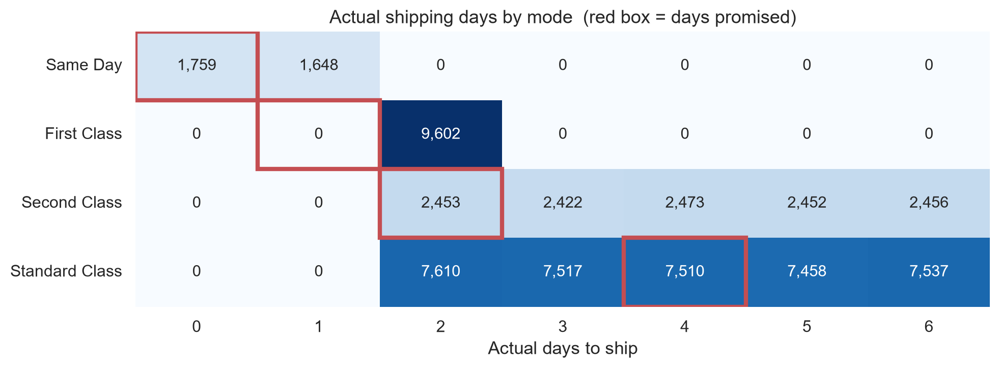
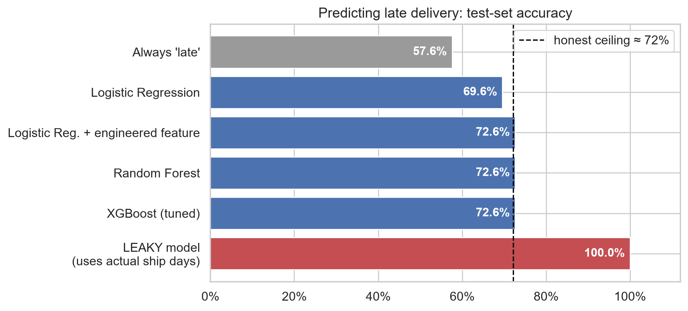
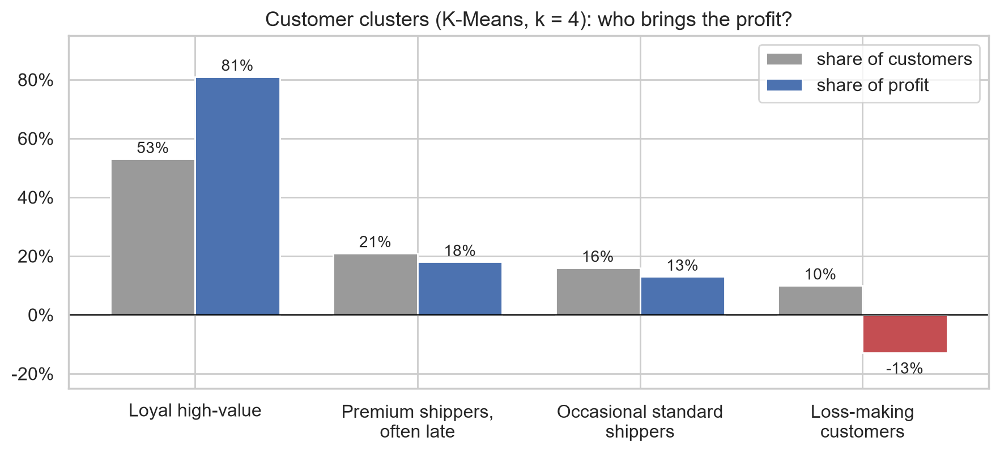

# 🚚 Can We Flag a Late Order Before It Ships?

**A leakage-free study of delivery risk on the DataCo Smart Supply Chain dataset (180,519 rows, 2015–2018)**

    

M.S. Data Science final project, University of St. Thomas, Houston · Muhammad Imran Syed

## TL;DR
- **57% of shipped orders arrive late.** The cause is the shipping promise, not the region, customer or product.
- Using only what's known **when the order is placed**, the best possible accuracy is **about 72%**. Logistic Regression (plus one engineered feature), Random Forest and tuned XGBoost all reach it.
- Public notebooks claiming ~99% accuracy use actual shipping days as an input, so they **leak the answer**. I reproduce that leak (100% accuracy) to show it.
- A cost-based threshold (0.23) raises late-order recall from 59% to **99.9%** and cuts the cost of mistakes by about two-thirds.



## Questions
| Technique | Question | Target |
|---|---|---|
| Classification | Will this order be late? | `Late_delivery_risk` |
| Regression | How many days will shipping take? | `Days for shipping (real)` |
| Clustering | Which customer groups exist, and which matter most? | customer features |

## Method: three rules against leakage
1. **Order-time features only.** Actual shipping days, delivery status and order status are never inputs.
2. **Test on the future.** Train Jan 2015 – Jun 2017 (49,826 orders), test Jul 2017 – Jan 2018 (13,071 orders), tune with time-ordered CV.
3. **One row per order**, so the same order never appears in both train and test.

## Key findings
- **First Class** always takes 2 days but promises 1, so it is **100% late**.
- **Second and Standard Class** take the same 2–6 days. Second Class just promises less, so it's 80% late vs 40%.
- **A hidden noon cut-off:** Same Day orders placed before 12:00 are always on time, and after 12:00 always late.
- Region, market, segment, category, payment type, weekday and month have no meaningful effect (Cramér's V ≤ 0.03).

| Model | Accuracy | Recall (late) | ROC-AUC |
|---|---|---|---|
| Always "late" baseline | 57.6% | 100% | – |
| Logistic Regression | 69.6% | 53.9% | 0.753 |
| Logistic Regression + "Same Day after noon" | **72.6%** | 59.2% | **0.781** |
| Random Forest | **72.6%** | 59.2% | 0.780 |
| XGBoost (tuned) | **72.6%** | 59.2% | 0.779 |
| XGBoost, cost-based threshold 0.23 | 60.1% | **99.9%** | 0.779 |
| *Leaky Random Forest (uses actual days)* | *100%* | *100%* | *1.000* |

**Feature engineering beat model complexity.** Regression models reach the calculated limit too (RMSE 1.26 days, R² 0.39).



### Customer segments (K-Means, k = 4, confirmed with Ward clustering)
| Cluster | Customers | Share of profit |
|---|---|---|
| Loyal high-value | 53% | **81%** |
| Premium shippers, often late | 21% | 18% |
| Occasional standard shippers | 16% | 13% |
| Loss-making customers | 10% | **−13%** |



## Recommendations
1. Change the First Class promise to 2 days. This alone removes about 27% of late orders.
2. Fix or re-price Second Class; it ships no faster than Standard.
3. Show the 12:00 Same Day cut-off at checkout.
4. Quote a range ("2–6 days") instead of a single date.
5. Win back the "premium, often late" customers and review pricing for loss-making ones.

Full write-up: **[REPORT.md](REPORT.md)**

## Repository
```
notebooks/
  01_data_audit.ipynb               cleaning, leakage check, data dictionary
  02_eda_delivery_and_profit.ipynb  what drives late delivery and losses
  03_classification_late_risk.ipynb LR, RF, XGBoost, threshold tuning
  04_regression_shipping_days.ipynb shipping-day regression
  05_clustering_customers.ipynb     K-Means + hierarchical clustering
  06_findings_summary.ipynb         final charts
figures/                            charts used in the report
data_dictionary_with_usage.csv      every column and whether it was used
```

## Run it
1. Download the [DataCo Smart Supply Chain dataset](https://www.kaggle.com/datasets/shashwatwork/dataco-smart-supply-chain-for-big-data-analysis) (`DataCoSupplyChainDataset.csv`).
2. Open the notebooks in Google Colab or Jupyter, point `data_dir` at the CSV, and run them in order (01 creates the cleaned files the others use).

## Limitations
The data looks partly simulated (shipping days uniformly random within 2–6, ~19% loss rate in every group), customer IDs reset in Oct 2017, and there's no carrier or distance information. The 5:1 cost weights are assumptions.
